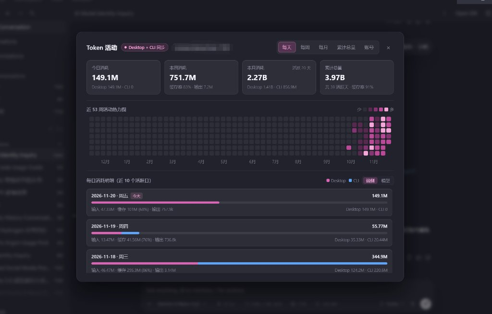
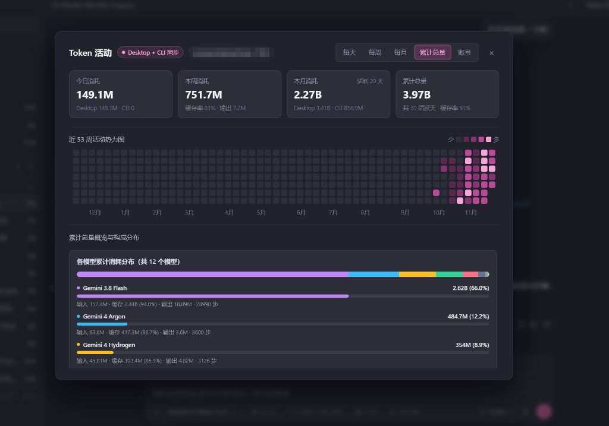
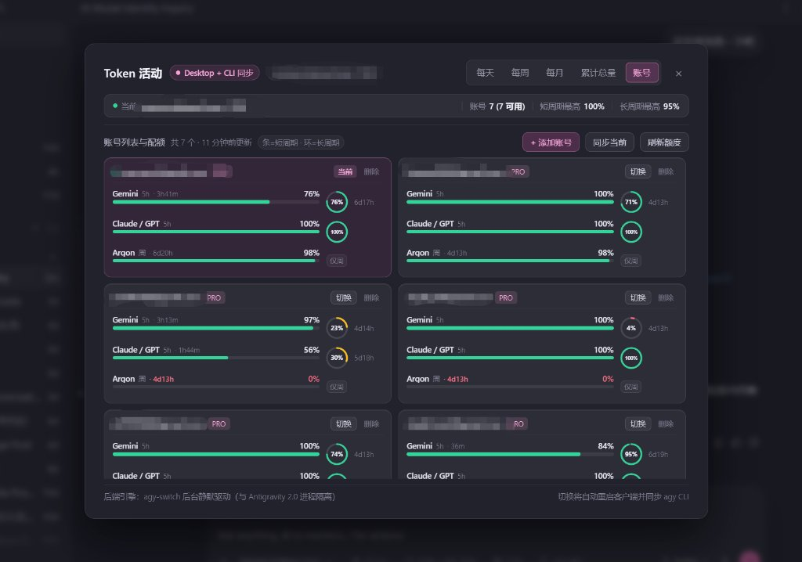

# Antigravity Token Pulse

[](LICENSE)
[](#快速安装一秒上手)

为 **Google Antigravity 2.0 桌面端** 与 **Antigravity CLI (`agy`)** 打造的轻量级**实时 Token 遥测栏**、**Token 活动热力图面板**与**内置多账号配额管理引擎**（纯本地统计、零第三方遥测、开箱即用）。

---

## 界面预览

### 1. Token 活动热力图与每日消耗明细（Desktop + CLI 双端同步）



### 2. 累计总量与各模型消耗分布（含分模型独立缓存命中率）



### 3. 内置多账号管理与实时双周期配额仪表盘（当前账号置顶）



---

## 核心特性

### 1. 实时遥测状态栏（Antigravity 2.0 桌面端 + `agy` CLI）
- **`⚡ t/s` 生成速率**：实时测算当前对话输出吞吐速率
- **上下文环形进度图 (`used / 1M · pct%`)**：桌面端与 `agy` CLI 统一采用 **`1M`（`1,000,000` tokens）固定上下文窗口口径**计算并展示占用与百分比（如 `128k / 1M · 13%`），确保两端读数完全一致（客户端实际自动压缩阈值仍以官方默认行为为准）
- **`Cache%` 缓存命中率**：基于累计 Prompt Cache Read Token 占比实时统计
- **`Σ` 累计消耗**：会话级累计 Token 总量（统一英文紧凑单位 `k` / `M` / `B`）

### 2. Token 活动热力图与分模型账本面板（点击遥测栏展开）
- 点击遥测栏任意位置，打开活动分析弹窗：
  - **每天 (Daily)**：类似 GitHub Contribution 的 53 周热力矩阵，直观查看每日 Token 消耗与热区分布
  - **每周 (Weekly)**：按自然周聚合统计周度 Token 消耗对比
  - **每月 (Monthly) / 累计总量**：按月度及全历史周期统计 Token 消耗总账与构成分布；「累计总量」页面同时展示**各模型独立的缓存命中率**（`输入 · 缓存 (XX.X%) · 输出 · 步数`），直观对比不同模型的缓存效率
- **`[端侧 | 模型]` 一键切换与动态模型配色**：
  - 支持在「端侧分布（Desktop / CLI）」与「模型分布（按主模型聚合，自动合并思考档位）」之间一键切换
  - **零硬编码动态识别**：直接从本地会话账本与 SQLite 元数据提取模型列表（兼容官方 `@default` / 日期后缀及 `provider/` 前缀），未来上架或下架模型均可自动适配
  - **自适应浅 / 深色主题与丝滑缓动动效**：底栏文字、SVG 图标与 Token 活动弹窗自动感知 Antigravity 2.0 浅 / 深色主题实时切换，全部标签页的彩色进度条、构成条与配额圆环均采用统一的「由快到慢」自然缓动动效
- **桌面端 + CLI 数据自动合并**：`agy` CLI 的实时 Token 消耗会自动同步到 `~/.gemini/telemetry-activity-cache.json`（支持 `ANTIGRAVITY_CLI_HOME` 自定义路径），桌面端热力图自动聚合 Antigravity 2.0 与 `agy` 两端历史对话账本。

### 3. 内置多账号管理与实时配额仪表盘（开箱即用、无需编译 Rust）
- **核心内置模块 & 进程隔离架构**：**「账号」**标签页作为本项目核心 5 大视图（`每天 | 每周 | 每月 | 累计总量 | 账号`）常驻展示，且统一固定为「每天」视图基准尺寸，切换无跳动。渲染层本身**不接触**任何 Token / OAuth 密钥，所有账号读写、Google OAuth 授权与重启切换均交由项目内置的独立轻量引擎 [`agy-switch-lite`](tools/agy-switch-lite/README.md)（~3 MB）后台进程隔离执行。
- **零编译自动部署（GitHub Actions 公开构建）**：
  - 本仓库已配置 GitHub Actions 工作流（[`.github/workflows/release-agy-switch.yml`](.github/workflows/release-agy-switch.yml)），基于公开源码 `tools/agy-switch-lite/` 在官方 `windows-latest` 环境自动编译并发布附带 SHA-256 校验值的预编译引擎至 GitHub Releases；
  - 普通用户**无需安装 Rust 或手动编译**——双击运行 `Antigravity-Telemetry-Installer.bat` 时，安装器会自动下载、校验 SHA-256 并部署 `agy-switch.exe` 到 `%LOCALAPPDATA%\agy-switch\agy-switch.exe`；若离线未部署，面板内也会保留「账号」页并提供一键重新检测与 Release 下载引导。
- **核心交互（当前账号置顶 + 双列动态仪表盘）**：
  - **当前登录账号始终排在第一位**：顶部为单行轻量状态条（当前激活账号 / 可用数 / 短周期与长周期最高余量），账号列表采用双列自适应网格（窄屏自动退回单列），当前正在使用的账号自动置顶高亮，零硬编码动态适配 Free / Pro / Ultra 等不同套餐的任意模型池数量与限额周期；
  - **三点一线可视化配额与快→慢动效**：每个双周期池采用「左短周期细进度条（正对圆环 9 点钟）+ 右 32px 动态外圈进度圆环（环内直接显示 `XX%` / `100%`）+ 3 点钟独立长周期重置倒计时（满额自动隐藏、耗尽标红）」；单周期池（如 Argon 仅周额度）自动以进度条 + 对齐标签（如 `仅周`）展示；
  - **自动对齐当前登录账号 (`同步当前`)**：打开弹窗时会自动静默对齐并导入当前正在登录的 Antigravity 2.0 账号，也可随时手动点击 **「同步当前」**；
  - **无黑框添加账号 (`+ 添加账号`)**：原生无头 `add --json` 直接打开系统浏览器完成 Google OAuth 登录（全程无黑框）；面板内提供「重新打开浏览器 / 复制链接 / 取消」，授权完成后自动同步；
  - **删除账号 (`删除`)**：内联二次确认（**「确认 / 取消」**）后调用原生 `delete <id> --json` 原子清理，不影响当前运行会话；
  - **极速并发刷新额度 (`刷新额度`)**：手动按需触发多账号并发刷新（默认 20 并发、可通过 `AGY_SWITCH_REFRESH_CONCURRENCY` 在 `1~32` 间自定义）+ 单账号 3 接口并发 + 全局 HTTP/2 连接池复用；
  - **无感重启切换 (`切换`)**：内联二次确认（**「确认 / 取消」**）防误触；确认后由独立进程优雅关闭、写入凭据并自动重新拉起 Antigravity 2.0，同步切换桌面端与 `agy` CLI。
- **内置轻量引擎安全特性（[`tools/agy-switch-lite/`](tools/agy-switch-lite/README.md)）**：
  - 纯 Rust 无头引擎（仅 ~3 MB、无 GUI/WebView/TUI/托盘/反代冗余模块），仅直连 Google 官方接口；
  - **Windows DPAPI 本机用户级加密**：所有保存于 `~/.antigravity_tools/accounts/*.json` 的 `access_token` / `refresh_token` / `id_token` 及本地 OAuth 客户端缓存均自动以 Windows `CryptProtectData`（`dpapi:v1:`）加密落盘，旧版明文文件首次读取时自动无感迁移为密文；
  - **源码零硬编码 OAuth 密钥**：运行期按「环境变量 → 本地 DPAPI 缓存 → 自动从本机官方 Antigravity 2.0 / `agy` CLI 定位并校验」解析；
  - **WMI 脱离 Job 稳定重启**：自动检测 Windows Job Object `KILL_ON_JOB_CLOSE` 限制并通过 WMI `Win32_Process.Create`（`ShowWindow = 0`）脱离宿主进程树，确保关闭客户端后可靠完成凭据写入与客户端重启。
- **引擎路径探测顺序**（默认自动部署到 `%LOCALAPPDATA%\agy-switch\agy-switch.exe`，也兼容自定义或第三方兼容 CLI）：
  1. 环境变量 `ANTIGRAVITY_SWITCH_CLI`（可填可执行文件路径或其所在目录）
  2. 本地配置文件 `~/.gemini/telemetry-switch-cli.json` 中的 `{"cliPath": "..."}`
  3. 默认安装目录 `%LOCALAPPDATA%\agy-switch\agy-switch.exe`（安装器自动部署位置）、`%LOCALAPPDATA%\Programs\agy-switch\agy-switch.exe`、`~/.gemini/tools/agy-switch/agy-switch.exe` 及系统 `PATH`

### 4. 一键安装 / 升级 / 还原
- [`Antigravity-Telemetry-Installer.bat`](Antigravity-Telemetry-Installer.bat) 内置纯 Windows PowerShell + .NET **内存级 ASAR 注入与 SHA-256 多块完整性重算引擎**，一站式完成桌面端补丁、内置账号引擎部署与 CLI 状态栏配置：
  - **无需安装 Node.js / npm / `asar` / Rust**（仅 `agy` CLI 状态栏需要 Node.js >= 18）
  - **独立进程重启 & 终端自动关闭**：安装完成后通过 WMI `Win32_Process.Create` 在独立宿主进程树拉起 Antigravity 2.0（与终端进程树/Job Object 完全隔离），终端窗口在 2 秒后自动关闭且绝不连带关闭 Antigravity
  - **双模式资源加载**：
    - 下载仓库 ZIP 解压或 `git clone` 后运行，直接读取同目录 `src/` **离线注入**，并自动从 GitHub Releases 部署（或优先同步本地已构建的）`agy-switch.exe`
    - 仅单独下载 `Antigravity-Telemetry-Installer.bat` 时，自动从 GitHub Raw / jsDelivr 多镜像拉取 `src/` 模块并自动下载校验 `agy-switch.exe`
  - **多来源自动探测**：通过当前用户会话进程路径、Windows 注册表卸载项（`HKCU` / `HKLM` / `WOW6432Node`）及常见安装目录自动定位 `app.asar`
  - **安全防护**：写入前检测 `Antigravity.exe` Electron Fuse `EnableEmbeddedAsarIntegrityValidation` 熔断位；若本机存在 `node`，自动使用 `vm.Script` 对修改后的脚本做语法预校验，并验证 ASAR JSON 头与所有文件偏移及分块 SHA-256 完整性后再原子替换
  - 首次或客户端升级后自动备份干净原版为 `app.asar.bak`，支持随时重新运行一键**升级/重新注入**或**恢复官方原版**

---

## Antigravity 2.0 与 Antigravity IDE 的区别

| 产品形态 | 内核与目录特征 | 桌面端注入支持 | `agy` CLI 状态栏 |
| :--- | :--- | :--- | :--- |
| **Antigravity 2.0 桌面端** | 独立 Electron 客户端，安装目录下包含 `resources\app.asar`（及 `resources\app.asar.unpacked`） | **支持**（自动注入遥测栏、热力图与内置多账号管理面板） | **支持** |
| **Antigravity IDE** | 基于 VS Code 内核，应用目录为解包形式 `resources\app\`（**无 `app.asar`**） | **不适用**（安装器会提示区分并自动跳过桌面端） | **支持**（可照常自动配置 CLI 状态栏） |

> 如果你的电脑仅安装了 Antigravity IDE（没有安装 Antigravity 2.0 桌面端），运行安装器时会看到明确的友好提示，并直接继续完成 `agy` CLI 状态栏配置。

---

## 快速安装一秒上手（Windows 推荐）

### 方式一：下载完整 ZIP（推荐）
1. 点击仓库右上角 **Code -> Download ZIP**（或执行 `git clone https://github.com/Hsanli060/antigravity-token-pulse.git`）
2. 解压后双击运行根目录的 `Antigravity-Telemetry-Installer.bat`（如果 Antigravity 安装在 `C:\Program Files` 下，请**右键 -> 以管理员身份运行**）
3. 自动完成桌面端补丁注入、内置账号引擎 `agy-switch.exe` 部署、独立进程重启 Antigravity 2.0 并自动关闭终端窗口；点击底栏遥测条即可打开 Token 活动热力图与多账号管理面板。

### 方式二：仅下载单个安装脚本
1. 右键「另存为」下载 [`Antigravity-Telemetry-Installer.bat`](https://raw.githubusercontent.com/Hsanli060/antigravity-token-pulse/main/Antigravity-Telemetry-Installer.bat)（保留 `.bat` 后缀；仓库已配置 `.gitattributes` 使 `Download ZIP` 与 `git clone` 自动签出标准 CRLF，且脚本第 1 行为纯 ASCII 单行引导头，即使从 Raw 直接下载得到 LF 行尾也可在 `cmd.exe` 下正常执行）
2. 双击运行即可自动拉取 `src/` 模块与预编译 `agy-switch.exe` 账号引擎并完成全部安装。

### 无交互模式与环境变量（CMD / PowerShell 双示例）

安装器支持通过环境变量指定目标路径、自定义 CLI 目录与无交互模式（自动跳过暂停与交互菜单）：
- `ANTIGRAVITY_ASAR_PATH`：指定 `app.asar` 或 Antigravity 安装目录路径（设置后不会关闭宿主当前运行的 Antigravity 进程）
- `ANTIGRAVITY_CLI_HOME`：自定义 CLI 配置目录（默认 `%USERPROFILE%\.gemini\antigravity-cli`）
- `ANTIGRAVITY_INSTALLER_MODE`：`install`（安装/升级）或 `restore`（卸载还原）
- `ANTIGRAVITY_UPDATE_SWITCH_ENGINE`：设为 `1` 时强制重新从 GitHub Releases 拉取最新版 `agy-switch.exe`
- `ANTIGRAVITY_SWITCH_DOWNLOAD_URL`：自定义 `agy-switch.exe` 镜像下载地址（可选）

**CMD 示例：**

```bat
set "ANTIGRAVITY_INSTALLER_MODE=install"
set "ANTIGRAVITY_ASAR_PATH=%LOCALAPPDATA%\Programs\Antigravity\resources\app.asar"
set "ANTIGRAVITY_CLI_HOME=%USERPROFILE%\.gemini\antigravity-cli"
cmd.exe /c Antigravity-Telemetry-Installer.bat
```

还原卸载（CMD）：

```bat
set "ANTIGRAVITY_INSTALLER_MODE=restore"
cmd.exe /c Antigravity-Telemetry-Installer.bat
```

**PowerShell 示例：**

```powershell
$env:ANTIGRAVITY_INSTALLER_MODE = "install"
$env:ANTIGRAVITY_ASAR_PATH = "$env:LOCALAPPDATA\Programs\Antigravity\resources\app.asar"
$env:ANTIGRAVITY_CLI_HOME = "$env:USERPROFILE\.gemini\antigravity-cli"
cmd.exe /c .\Antigravity-Telemetry-Installer.bat
```

还原卸载（PowerShell）：

```powershell
$env:ANTIGRAVITY_INSTALLER_MODE = "restore"
cmd.exe /c .\Antigravity-Telemetry-Installer.bat
```

> **客户端更新后怎么办？**
> 当 Antigravity 2.0 官方自动更新覆盖了 `app.asar` 时，只需**再次双击** `Antigravity-Telemetry-Installer.bat`，1 秒即可无损恢复遥测栏与热力图，所有历史 Token 数据自动保留。

> **如何卸载 / 恢复官方原版？**
> 再次双击运行 `Antigravity-Telemetry-Installer.bat`，在菜单中输入 `2` 并回车，即可从 `app.asar.bak` 还原官方原版（或自动剥离注入块）并清理 CLI 托管配置。

---

## 含空格用户名 / 路径回退机制说明（`agy` CLI 状态栏）

1. **Node.js >= 18 前置校验**：在向 `settings.json` 写入 `"enabled": true` 之前，安装器会先通过 `cmd.exe /c node -v` 校验本机 Node.js 是否存在且主版本 `>= 18`。若未检测到 Node >= 18，会明确警告并跳过启用 `statusLine`，防止 `agy` 因执行命令失败而自动禁用状态栏。
2. **含空格路径自动规避**：由于 Windows `cmd.exe` 解析命令行时未加引号的空格路径会被截断，当 `%USERPROFILE%\.gemini\antigravity-cli` 路径包含空格（如用户名含空格）时，安装器会按以下顺序自动探测**不含空格且可写**的部署路径：
   1. 优先尝试当前目录的 Windows 8.3 短路径（若卷启用了短文件名且可写）
   2. 通过 `Test-DirWritable` 可写性测试回退至 `%ProgramData%\antigravity-telemetry\agy-statusline.js`
   3. 若 `%ProgramData%` 不可写，继续通过 `Test-DirWritable` 测试回退至 `%PUBLIC%\antigravity-telemetry\agy-statusline.js`（或系统盘根目录下的 `antigravity-telemetry`）

---

## 手动注入 / 开发者方式

### 方式 A：直接对 `app.asar` 原地注入（推荐，自动保留 `app.asar.unpacked`）

`src/patch-asar.js` 已内置完整的 ASAR 读写、多块 SHA-256 校验、Electron Fuse 检查与 `vm.Script` 语法预校验，无需手动解包即可原地安全注入：

**CMD：**
```bat
node src\patch-asar.js "%LOCALAPPDATA%\Programs\Antigravity\resources\app.asar"
:: 如需还原：
node src\patch-asar.js "%LOCALAPPDATA%\Programs\Antigravity\resources\app.asar" --restore
```

**PowerShell：**
```powershell
node src/patch-asar.js "$env:LOCALAPPDATA\Programs\Antigravity\resources\app.asar"
# 如需还原：
node src/patch-asar.js "$env:LOCALAPPDATA\Programs\Antigravity\resources\app.asar" --restore
```

### 方式 B：手动解包 / 打包（注意 `app.asar.unpacked`）

> ⚠️ **重要提醒**：`resources` 目录下存在与 `app.asar` 配套的 **`app.asar.unpacked`** 原生二进制与 MCP 模块目录！
> 如果你手动解包并重新打包 `app.asar`，**切勿删除或破坏 `resources\app.asar.unpacked`**，也不要在不保留 `unpacked` 标记的情况下重打（`@electron/asar extract` 默认不会把原生 `.node` / 外部解压资源重新写回原路径关系；重打包时建议先完整备份 `app.asar` 与 `app.asar.unpacked`，并在同级存在 `app.asar.unpacked` 的情况下使用 `--unpack` 规则保持原生模块清单一致，或直接使用上方**方式 A** 原地修改 `app.asar`）。

**CMD：**
```bat
copy "%LOCALAPPDATA%\Programs\Antigravity\resources\app.asar" "%LOCALAPPDATA%\Programs\Antigravity\resources\app.asar.bak"
npx @electron/asar extract "%LOCALAPPDATA%\Programs\Antigravity\resources\app.asar" app-extracted
node src\patch-asar.js app-extracted
npx @electron/asar pack app-extracted "%LOCALAPPDATA%\Programs\Antigravity\resources\app.asar" --unpack "{*.node,**/chrome-devtools-mcp/**}"
```

**PowerShell：**
```powershell
Copy-Item "$env:LOCALAPPDATA\Programs\Antigravity\resources\app.asar" "$env:LOCALAPPDATA\Programs\Antigravity\resources\app.asar.bak"
npx @electron/asar extract "$env:LOCALAPPDATA\Programs\Antigravity\resources\app.asar" app-extracted
node src/patch-asar.js app-extracted
npx @electron/asar pack app-extracted "$env:LOCALAPPDATA\Programs\Antigravity\resources\app.asar" --unpack "{*.node,**/chrome-devtools-mcp/**}"
```

### 单独配置 Antigravity CLI (`agy`)

确保本机已安装 **Node.js >= 18**（`cmd.exe /c node -v` 可用），将 [`src/agy-statusline.js`](src/agy-statusline.js) 放到**不含空格的可写路径**（例如 `~/.gemini/antigravity-cli/agy-statusline.js`、或用户名含空格时放到 `C:\ProgramData\antigravity-telemetry\agy-statusline.js` / `C:\Users\Public\antigravity-telemetry\agy-statusline.js`），并在 `~/.gemini/antigravity-cli/settings.json`（使用**无 BOM UTF-8** 编码）中合并以下配置：

```json
{
  "statusLine": {
    "type": "command",
    "command": "node C:/Users/Public/antigravity-telemetry/agy-statusline.js",
    "enabled": true
  }
}
```

---

## 目录结构

```text
antigravity-token-pulse/
├── .github/workflows/
│   └── release-agy-switch.yml            # GitHub Actions 自动构建并发布带 SHA-256 校验的 agy-switch.exe
├── .gitattributes                        # 显式 *.bat/*.cmd 为 CRLF（配合单行引导头兼容 Raw LF 与 ZIP），*.js/*.md 为 LF
├── Antigravity-Telemetry-Installer.bat   # 一键安装 / 升级 / 恢复器（自动部署内置账号引擎、独立进程重启并自动关闭终端）
├── docs/images/                          # README 界面预览效果图
│   ├── preview-daily.jpg
│   ├── preview-models.jpg
│   └── preview-accounts.jpg
├── src/
│   ├── patch-asar.js                     # 桌面端 ASAR 独立注入脚本（支持目录与 .asar 原地注入/还原）
│   ├── ipc-block.js                      # Electron 主进程 IPC 数据采集、账本聚合与内置账号引擎桥接模块
│   ├── preload-part1.js                  # 渲染层样式表与主题/工具函数模块 (1/3)
│   ├── preload-part2.js                  # Token 活动热力图与内置多账号管理弹窗视图模块 (2/3)
│   ├── preload-part3.js                  # 实时遥测栏 DOM 挂载与轮询模块 (3/3)
│   └── agy-statusline.js                 # agy CLI 终端状态栏 + Token 缓存同步脚本
├── tests/
│   └── account-switcher-bridge.test.js   # 账号引擎桥接安全、排序、解析、隐私扫描与注入语法自动化测试
├── tools/
│   └── agy-switch-lite/                  # 内置精简无头 Rust 账号引擎源码（~3 MB，CI 自动编译发布、支持 DPAPI 加密与并发刷新）
│       ├── Cargo.toml
│       ├── Cargo.lock
│       ├── README.md
│       └── src/
│           ├── main.rs                   # 无头 JSON CLI 入口（sync/list/add/delete/refresh/switch）
│           ├── dpapi.rs                  # Windows DPAPI 本机用户级凭证加解密模块
│           ├── oauth.rs                  # 零硬编码密钥运行期解析与本地回环 OAuth 授权流
│           ├── quota.rs                  # Google Cloud Code 并发配额查询模块
│           ├── store.rs                  # 原子读写、DPAPI 自动迁移与切换互斥锁
│           ├── system.rs                 # WinCred、state.vscdb 注入、WMI 脱离 Job 稳定重启
│           ├── protobuf.rs               # state.vscdb Unified State Sync Protobuf 编解码
│           └── models.rs                 # 账号与动态配额组数据结构
├── .gitignore
├── LICENSE                               # MIT License
└── README.md
```

---

## 隐私与安全说明

- **100% 本地统计**：所有 Token 读取与热力图统计均只访问本地 `~/.gemini/antigravity/...`、`~/.gemini/antigravity-cli/...` 与 `~/.gemini/telemetry-activity-cache.json`，**不上传任何对话或统计数据到任何服务器**。
- **内置账号引擎安全边界**：账号切换 IPC 仅校验本地 `localhost`/`127.0.0.1` 顶层来源、以 `shell: false` 严格白名单调用独立进程 `agy-switch.exe`，**绝不向渲染层传递任何 Token / 密钥字段**。
- **公开可复现构建 + SHA-256 校验**：普通用户无需编译 Rust；`Antigravity-Telemetry-Installer.bat` 自动下载的预编译引擎由 GitHub Actions 基于仓库公开源码 `tools/agy-switch-lite/` 自动构建并核验 SHA-256 摘要，开发者亦可随时本地 `cargo build --release` 自行编译覆盖。
- **DPAPI 加密与零硬编码密钥（`tools/agy-switch-lite`）**：账号本地缓存中的 `access_token` / `refresh_token` / `id_token` 均采用 Windows DPAPI 本机用户级加密（`dpapi:v1:`），源码仓库内不包含任何 Google OAuth `client_id` / `client_secret`、个人路径或邮箱，且所有网络请求仅直连 Google 官方域名。
- **全部源码可审计**：`src/` 下所有注入模块为明文 JavaScript，`tools/agy-switch-lite/` 为完整 Rust 源码，构建日志公开可查。

---

## License

[MIT](LICENSE)
